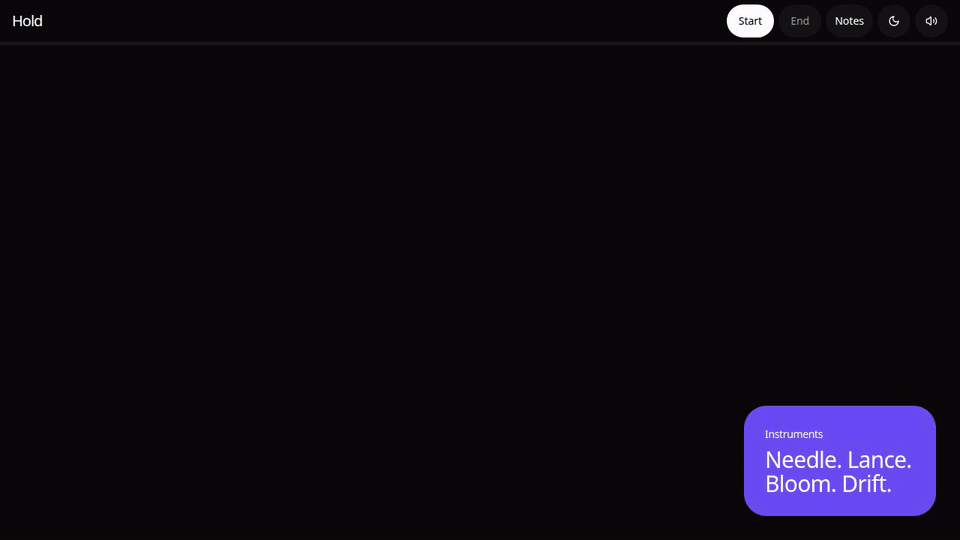

# Hold

A tower defense on a fixed route. Four instruments, twelve waves.

Gold from what you break, lives from what gets through.



Play the live field: https://hold-six.vercel.app

## Run

```bash
npm install && npm start
```

Then open http://localhost:8080.

## Play

- **Start** opens a field, sends the next wave, or runs it back.
- **End** closes the field and keeps the score.
- Plant off the route. The ribbon itself is closed.
- Send a wave before the clock for an early bonus.
- The sun and moon switch between the dark field and paper light.

Keys: `1-4` choose an instrument, Space sends or pauses, Esc clears a selection, Delete sells.
